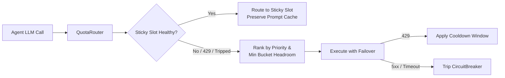

# llm-quota-router

**English** | [简体中文](README_CN.md)

[](https://github.com/huotianyyy/llm-quota-router/actions/workflows/ci.yml)
[](https://www.python.org/downloads/)
[](LICENSE)

Zero-dependency Python routing engine for **multi-account & multi-bucket LLM pools**. Built for long-running AI agent loops that need sticky prompt-cache locality, rolling quota-window tracking, HTTP 429 cooldowns, and circuit-breaker failover.

## Architecture



## Quickstart

```python
from llm_quota_router import ProviderAccount, QuotaBucket, QuotaRouter

accounts = [
    ProviderAccount(
        account_id="primary-1",
        provider="openai-compatible",
        models={"gpt-4o", "claude-sonnet"},
        buckets=[QuotaBucket("hourly", capacity=1000, remaining=850, window_seconds=3600)],
    ),
    ProviderAccount(
        account_id="backup-2",
        provider="openai-compatible",
        models={"gpt-4o", "claude-sonnet"},
        buckets=[QuotaBucket("hourly", capacity=1000, remaining=1000, window_seconds=3600)],
    ),
]

router = QuotaRouter(accounts, failure_threshold=3, rate_limit_cooldown=60.0)

response = router.execute_with_failover(
    model="claude-sonnet",
    preferred_account="primary-1",
    fn=lambda decision: call_upstream(decision.account_id, decision.model),
)
```

## Development

```bash
pip install -e ".[dev]"
pytest -v
```

## License

MIT
